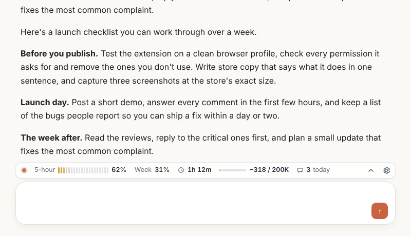
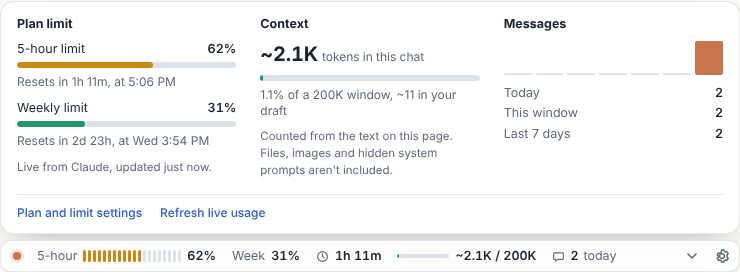
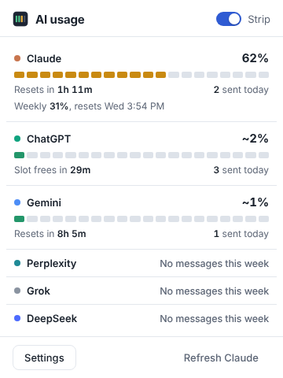
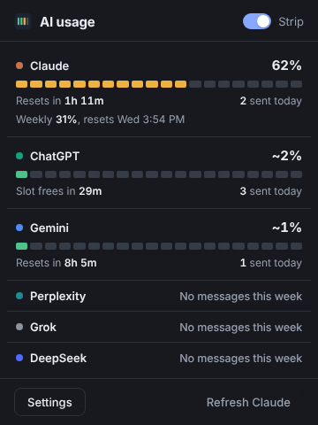

<p align="center"></p>

<h1 align="center">AI Usage Strip</h1>

<p align="center"><b>See how much of your AI chat limit is left, right above the chat box.</b></p>

<p align="center">
  <a href="https://github.com/Ramachokkalingam/ai-usage-strip/releases/latest"></a>
  <a href="https://github.com/Ramachokkalingam/ai-usage-strip/actions/workflows/ci.yml"></a>
  
  
  <a href="LICENSE"></a>
</p>

<p align="center">Live usage for Claude. Estimates for ChatGPT, Gemini, Perplexity and Grok. Context size and message count everywhere, DeepSeek included.</p>

<p align="center"></p>

## Why

You're deep in a task and the chat stops with "You've reached your limit". The usage page was two menus away the whole time. This extension keeps the numbers where you're already looking: a slim strip on top of the message box that shows your plan limit, when it resets, how full the conversation's context is, and how many messages you've sent today.

## Quick start

### Chrome, Edge, Brave, Opera or Arc

1. Download `ai-usage-strip-chromium-v1.0.0.zip` from the [latest release](https://github.com/Ramachokkalingam/ai-usage-strip/releases/latest) and unzip it.
2. Open `chrome://extensions` (Edge: `edge://extensions`) and turn on **Developer mode**.
3. Click **Load unpacked** and pick the unzipped folder.
4. Open [claude.ai](https://claude.ai) or [chatgpt.com](https://chatgpt.com). The strip appears above the chat box.

### Firefox 121 or newer

1. Download `ai-usage-strip-firefox-v1.0.0.zip` from the [latest release](https://github.com/Ramachokkalingam/ai-usage-strip/releases/latest).
2. Open `about:debugging#/runtime/this-firefox`, click **Load Temporary Add-on** and pick the zip.
3. If the strip doesn't appear, click the toolbar icon and choose **Allow access**.

Temporary add-ons are removed when Firefox restarts. A signed listing on addons.mozilla.org is on the [roadmap](#roadmap).

### From source

```sh
git clone https://github.com/Ramachokkalingam/ai-usage-strip.git
cd ai-usage-strip
npm run build        # no dependencies; writes dist/chromium and dist/firefox
```

Then load `dist/chromium` or `dist/firefox/manifest.json` as above.

## What the strip shows

| | |
| --- | --- |
| **Plan limit** | A 20-step meter and percentage. Green under 60%, amber to 85%, red above. A `~` means the number is an estimate. |
| **Reset timer** | Time until the limit resets, or until your oldest message leaves a rolling window. |
| **Context fill** | Roughly how many tokens the conversation holds, against the model's context window. |
| **Messages** | How many you've sent on that site today. |

Click the strip to open the details panel: every limit window with its reset time, the context breakdown including your draft, and a 7-day history.

<p align="center"></p>

The toolbar popup shows every site at once, and the toolbar icon carries the current site's percentage.

<p align="center">
  
  
</p>

## Supported sites

| Site | Plan limit | Default window |
| --- | --- | --- |
| Claude | **Live**, 5-hour and weekly, from your claude.ai usage | Session, 5 hours |
| ChatGPT | Estimated from messages you send | Rolling, 3 hours |
| Gemini | Estimated | Daily |
| Perplexity | Estimated | Daily |
| Grok | Estimated | Rolling, 2 hours |
| DeepSeek | No cap; context and message count only | |

Only Claude shares usage with the signed-in page. For the other sites the extension counts each message you send and compares it with the plan you pick in settings. Providers change their caps often, so the plan numbers are starting points you can edit. When a site shows a limit notice, the strip switches to **Limit reached** until the window resets.

## Features

- **Fits the site.** Matches light and dark themes, attaches to the chat box, and trims itself on narrow screens, dropping the least important parts first. If a layout gets in the way it floats instead.
- **Stays out of the way.** Lives in a shadow root, so it can't break the site's styles and the site can't break it. Keyboard accessible, respects reduced motion.
- **Adjustable.** Turn each part on or off, choose full or compact size, set your plan, limit, window and context size per site.
- **Private.** Everything stays in your browser. See [Privacy](#privacy).
- **Light.** Plain JavaScript with no dependencies; a 45 KB download.

## Privacy

- Message times and settings are stored only in your browser (`storage.local`).
- Nothing is sent to any server, and there are no analytics.
- On claude.ai the extension reads `/api/organizations/{id}/usage` with your own signed-in session, the same numbers as Settings, Usage.
- Message text is never stored. Context size is estimated from the page text on the fly.

## FAQ

**Is the Claude number exact?**
Yes. It's the same data claude.ai shows under Settings, Usage, refreshed every 90 seconds and a few seconds after you send. That endpoint isn't documented, so if it ever changes the strip falls back to an estimate and says so in the details panel.

**Why are the other sites estimates?**
ChatGPT, Gemini, Perplexity and Grok don't expose usage to the page. The strip counts what you send from this browser, so messages from your phone or another computer aren't included.

**How accurate is the context number?**
It's a floor. It counts the text on the page at about 4 characters per token for English, more for scripts like Tamil, Hindi or Chinese. Files, images and hidden system prompts aren't counted.

**The strip doesn't show up.**
Check that it's turned on in the popup, and in Firefox that the extension has access to the site. If a site was just redesigned, [open an issue](https://github.com/Ramachokkalingam/ai-usage-strip/issues/new/choose) with the site name; the chat box selector usually needs a one-line update.

**Can I add another AI site?**
Yes, it's a few lines. See [Adding a site](CONTRIBUTING.md#adding-a-site).

## How it works

```text
src/
├── manifest.json          one manifest for both browsers; the build trims it per browser
├── background.js          stores message times, live usage and limit alerts; sets the badge
├── shared/core.js         sites, plan presets, window maths, token estimate, formatting
├── content/sites.js       per-site chat box, layout and message selectors; Claude live usage
├── content/strip.js       the strip and details panel (shadow DOM)
├── content/main.js        finds the chat box, mounts the strip, counts sends
├── popup/                 toolbar popup
└── options/               settings page
```

- **Sends** are counted when you press Enter in the chat box or click its send button.
- **Window types:** *rolling* counts each message for the window length; *session* starts at your first message and resets in full; *daily* resets at a set hour.

## Roadmap

- [ ] Chrome Web Store and addons.mozilla.org listings
- [ ] Mistral Le Chat and Microsoft Copilot
- [ ] Separate caps per ChatGPT model
- [ ] Translations
- [ ] Keyboard shortcut to show or hide the strip

Ideas and votes go in [issues](https://github.com/Ramachokkalingam/ai-usage-strip/issues).

## Contributing

Contributions are welcome, especially support for new sites and fixes when a site changes its layout. Start with [CONTRIBUTING.md](CONTRIBUTING.md), or pick an issue labelled [good first issue](https://github.com/Ramachokkalingam/ai-usage-strip/labels/good%20first%20issue).

If the strip saves you from a surprise limit, a star helps other people find it.

## License

[MIT](LICENSE) © Ramachokkalingam
