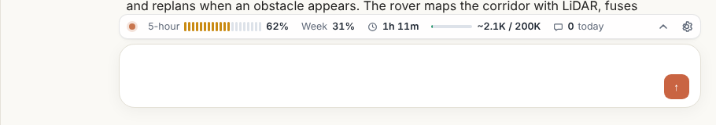
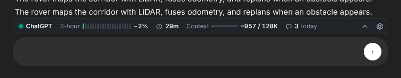

<p align="center"></p>

# AI Usage Strip

A browser extension that puts a slim usage strip right above the chat box on AI chat sites, so you can see how close you are to your limit before you hit it.




## What the strip shows

| Piece | What it tells you |
| --- | --- |
| **Plan limit** | How much of your plan's limit you've used, as a 20-step meter and a percentage. Green under 60%, amber to 85%, red above. |
| **Reset timer** | Time until the limit resets, or until your oldest message leaves a rolling window and frees a slot. |
| **Context fill** | Roughly how many tokens the current conversation holds, against the model's context window. |
| **Message count** | Messages you've sent on that site today. |

Click the strip (or the arrow) to open the details panel: every limit window with its reset time, a context breakdown including your draft, and a 7-day message history.


The toolbar popup shows every site at once, and the toolbar icon carries the current site's percentage as a badge.

<p>
  
  
</p>

## Supported sites

| Site | Plan limit source | Default window |
| --- | --- | --- |
| Claude (claude.ai) | **Live**, read from your claude.ai usage (5-hour and weekly) | Session, 5 hours |
| ChatGPT (chatgpt.com) | Estimated from messages you send | Rolling, 3 hours |
| Gemini (gemini.google.com) | Estimated | Daily |
| Perplexity (perplexity.ai) | Estimated | Daily |
| Grok (grok.com) | Estimated | Rolling, 2 hours |
| DeepSeek (chat.deepseek.com) | No cap by default, message count and context only | — |

Only Claude publishes usage to the signed-in page. For the others, the extension counts each message you send and compares it with the plan you pick in settings. The plan numbers are starting points; providers change their caps often, so edit them to match yours. If a site shows a "you've reached your limit" notice, the strip switches to **Limit reached** until the window resets.

## Install

### Chrome, Edge, Brave, Opera, Arc

1. Download or clone this repository, then run `npm run build` (needs Node 18+). Or use a release zip and unzip it.
2. Open `chrome://extensions` (Edge: `edge://extensions`).
3. Turn on **Developer mode**.
4. Click **Load unpacked** and pick the `dist/chromium` folder.

### Firefox (121 or newer)

1. Run `npm run build`.
2. Open `about:debugging#/runtime/this-firefox`.
3. Click **Load Temporary Add-on** and pick `dist/firefox/manifest.json`.
4. If the strip doesn't appear, open the extension popup and click **Allow access**. Firefox asks before letting extensions run on sites.

To install permanently in Firefox, submit `dist/ai-usage-strip-firefox-v*.zip` to [addons.mozilla.org](https://addons.mozilla.org/developers/) for signing.

## Settings

Open them from the gear on the strip or the **Settings** button in the popup.

- Show or hide each part of the strip.
- **Placement**: Automatic attaches the strip to the chat box and switches to floating when a site's layout gets in the way. You can force either.
- **Size**: Full or Compact. The strip also trims itself to fit narrow chat boxes, dropping the least important parts first.
- **Colors**: match the site's theme, or force light or dark.
- Per site: your plan, message limit, window type (rolling, session or daily), window length, daily reset time and context window size.
- Export your history as JSON, or clear it.

## Privacy

- Message times and settings are stored only in your browser (`storage.local`).
- Nothing is sent to any server. There's no analytics.
- On claude.ai, the extension reads `/api/organizations/{id}/usage` with your own signed-in session, the same data shown under Settings, Usage. That endpoint is undocumented and may change; if it fails, the strip falls back to an estimate and tells you so.
- Message text is never stored. Context size is estimated from the page text on the fly.

## How it works

```
src/
├── manifest.json          one manifest for both browsers; the build trims it per browser
├── background.js          stores message times, live usage and limit alerts; sets the badge
├── shared/core.js         sites, plan presets, window maths, token estimate, formatting
├── shared/tokens.css      colors and controls for the popup and settings page
├── content/sites.js       per-site chat box, layout and message selectors; Claude live usage
├── content/strip.js       the strip and details panel (shadow DOM)
├── content/strip-styles.js
├── content/main.js        finds the chat box, mounts the strip, counts sends
├── popup/                 toolbar popup
└── options/               settings page
```

- **Sends** are counted when you press Enter in the chat box or click its send button.
- **Context** is about 4 characters per token for English text, with more weight for scripts like Tamil, Hindi or Chinese that tokenize less efficiently. Files, images and hidden system prompts aren't counted, so treat it as a floor.
- **Window types**: *rolling* counts each message for the window length; *session* starts at your first message and resets in full; *daily* resets at a set hour.

### Adding a site

1. Add an entry to `AUS.SITES` and `AUS.SITE_ORDER` in `src/shared/core.js` (name, color, hosts, presets).
2. Add its URL pattern to `AUS.HOST_PATTERNS`, and to `host_permissions` and `content_scripts.matches` in `src/manifest.json`.
3. Optionally add an adapter in `src/content/sites.js` with the chat box selector. Without one, the extension finds the chat box on its own.

## Build

```sh
npm run build            # dist/chromium, dist/firefox and a zip of each
npm run build:chromium
npm run build:firefox
```

No dependencies. The build copies `src/`, writes a browser-specific manifest and zips the result.

## Known limits

- Sites redesign often. If the strip stops appearing on one, the chat box selector in `src/content/sites.js` usually needs an update; it falls back to automatic detection in the meantime.
- Estimates only count messages sent from this browser.
- ChatGPT has different caps per model; the estimate uses one cap per site.

## License

MIT © Ramachokkalingam
